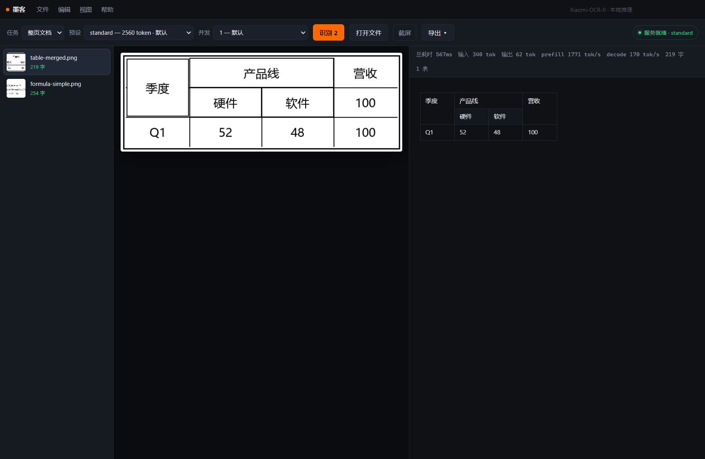
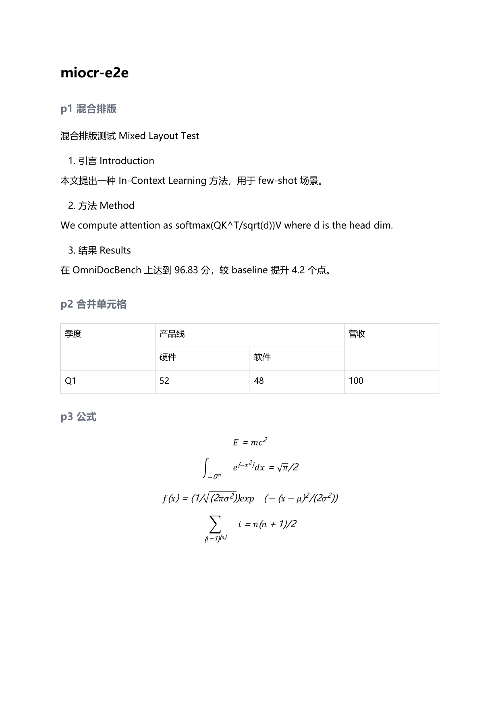
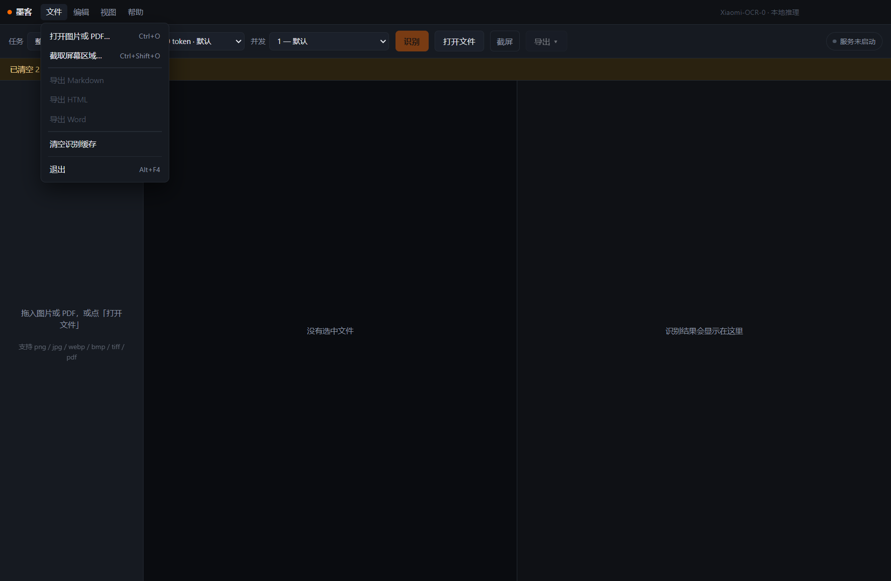
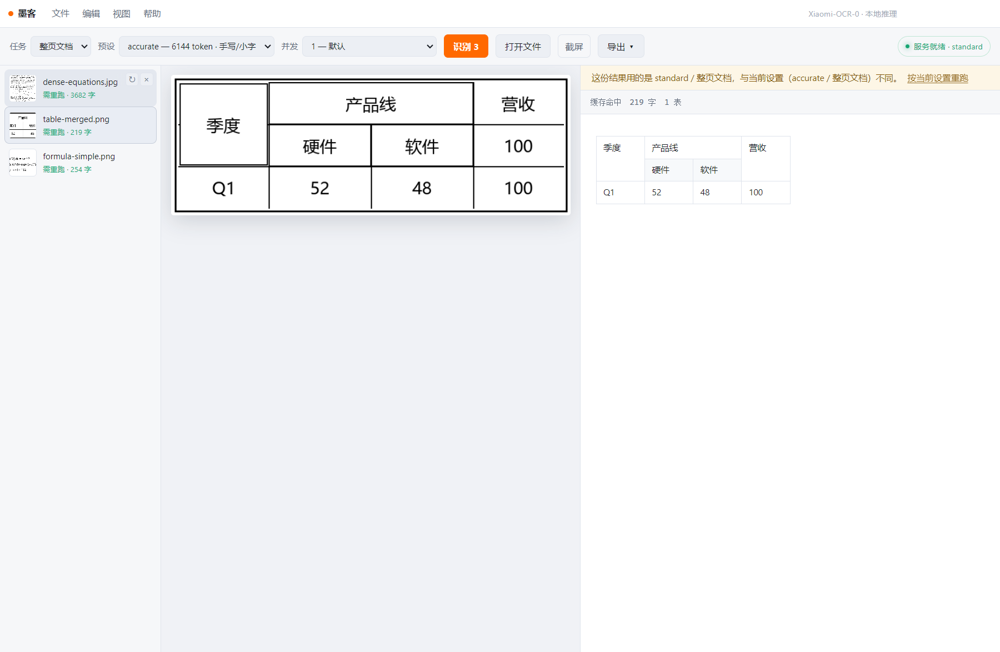
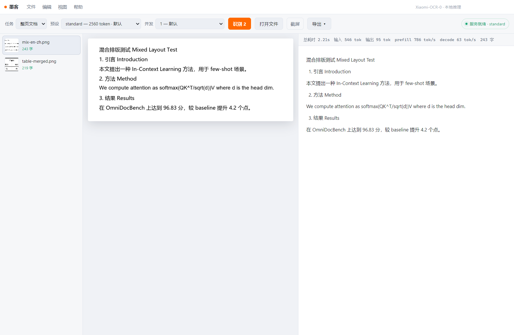
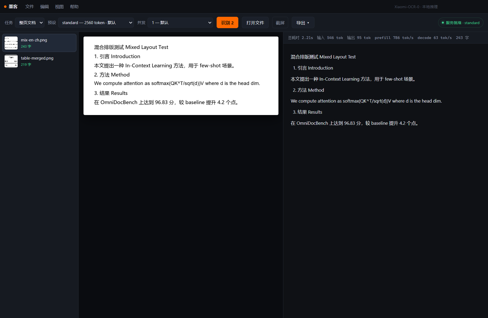

# 墨客 moocr

本地运行的 OCR 桌面工具。把图片或 PDF 丢进去，得到可用的 Markdown —— 表格保留合并单元格、公式变成能编辑的 Word 公式。

基于 [Xiaomi-OCR-0](https://huggingface.co/xiaomi-research/Xiaomi-OCR-0)（0.87B）+ llama.cpp Vulkan 后端。**全程本地，不联网，不上传。**

> **下载**：Windows 版见 [Releases](https://github.com/KevinZjYang/moocr/releases)，`moocr-0.2.0-setup-x64.exe`。安装包内置 llama.cpp 运行时，**模型权重在应用内一键下载**（约 700 MB，支持断点续传与镜像回退）。



---

## 它解决什么

通用 OCR（tesseract、PaddleOCR）擅长「把字认出来」，但输出是一堆带坐标的文本框。真正要放进文档时，你还得自己拼段落、重排表格、手抄公式。

moocr 直接输出**结构化的结果**：

- 整页 → Markdown，保持阅读顺序
- 表格 → `<table>`，`rowspan` / `colspan` 都在
- 公式 → LaTeX，导出 DOCX 时转成 OMML 原生公式对象（不是 LaTeX 源码文本）
- 收据 / 发票 → 按你给的 JSON 模板抽字段



上面这张是导出的 DOCX 转 PDF 的结果：4 条块公式与 2 条行内公式都是 Word 原生公式，可以在 Word 里双击编辑。

## 能力（实测，不是模型卡宣传）

测试平台 **Intel Arc A770 16 GB** + llama.cpp b12110 Vulkan + Q4_K_M。

| 能力 | 状态 | 实测表现 |
|---|---|---|
| 印刷文档整页 Markdown | ✅ 核心 | 字符准确率 88.9–100%（各测试样本） |
| 表格 → HTML | ✅ 核心 | 合并单元格正确，含嵌套表头 |
| 公式 → LaTeX | ✅ 核心 | 数学归一化后 94.8%，Word 里可编辑 |
| KIE → JSON | ✅ 核心 | 收据 6/6 字段，日期金额归一化正确 |
| PDF 逐页 | ✅ 核心 | 3 页 3.8 s |
| 日 / 俄 / 中英混排 | ✅ | 99–100% |
| 手写 | ⚠️ 需高保真档 | 74%（标准档）→ 85%（`accurate` 档，慢 2.3 倍） |
| 竖排中文 | ⚠️ 可读不保真 | 内容全对，但会自动补标点 |
| 繁体 | ⚠️ 输出简体 | 模型行为，无法配置 |
| 韩语 | ❌ | **模型级缺陷**：`주출`(추출)、`정화도`(정확도)，分辨率提到 1099 token 仍错 |
| 字符级 bbox | ❌ | 模型不输出坐标，只能做块级对照 |

完整测绘数据（含成本模型、退化扫描、nonce 测试）：[docs/CAPABILITY.md](docs/CAPABILITY.md)

## 速度

同一台机器实测：

| 场景 | 输入 token | 整页耗时 |
|---|---|---|
| 表格 / 短段落 | 340 | 0.7 s |
| 收据 | 1500 | 3.3 s |
| 密集公式页（A4） | 2400 | 12.5 s |
| 手写公式页（高保真档） | 8230 | 29 s |

decode 稳定 153–166 tok/s。瓶颈在图像编码（prefill），且**随像素数超线性增长**（约 950 token/MP，幂次接近平方）——所以画质档位是唯一的成本旋钮，UI 里给了四档。

## 安装（Windows）

下载 `moocr-0.2.0-setup-x64.exe`，双击安装（当前用户安装，不需要管理员）。首次启动会自动弹出「运行时就绪向导」：

1. 点「一键下载」——llama.cpp 运行时已在安装包里，这里只下两个模型文件（529 MB + 207 MB）；
2. 下载完自动校验 sha256、解压、预热模型，状态变绿即可识别；
3. 已有 gguf 的话可以「导入本地文件」，不必重新下载。

权重落在 `%APPDATA%\moocr\runtime\models`，升级或重装应用不会丢。全程只访问 Hugging Face / GitHub，不上传图片。

## 从源码运行

前置：**Node.js ≥ 22**、支持 Vulkan 的显卡驱动（Intel Arc / AMD / NVIDIA 均可）。

```bash
npm install
npm run fetch   # 下载 llama.cpp 运行时 + 模型权重，约 700 MB
npm start
```

开发版从仓库 `resources/` 读资产；打包版从安装目录与 `%APPDATA%\moocr\runtime` 读。两边用同一份 `packages/runtime/runtime-manifest.json`，所以 `npm run fetch` 下过的文件应用内也能识别。

暂不支持 CPU-only 和 macOS：前者能跑但整页要一分多钟，后者缺 Vulkan 成熟后端。

## 命令行

```bash
# 单张
npm run ocr -- scan.png

# 整个目录，4 路并发
npm run ocr -- ./pages --parallel 4 --out ./out

# 指定任务与画质档
npm run ocr -- receipt.jpg --task kie --preset accurate --json
```

| 参数 | 说明 |
|---|---|
| `--task` | `document` / `text` / `table` / `formula` / `kie` |
| `--preset` | `fast`(1024) / `standard`(2560) / `accurate`(6144) / `extreme`(12288) |
| `--parallel` | 并发页数，短页用 1，大页用 2–4 |
| `--attach` | 连到已在运行的服务，不自己启停 sidecar |

## 界面

菜单与标题栏合成一行，右上角是系统窗口按钮。界面只有三栏：文件列表、原图、识别结果。



- 拖入图片或 PDF，PDF 自动拆页
- 识别**按文件**处理：点「识别」只跑还没结果、或结果已过期的页；中途加文件不会把已识别的重跑一遍
- 每个文件行悬停出现 `↻`（只重跑这一页）和 `×`（从列表移除）
- 改了预设或任务后，旧结果的角标变成橙色「需重跑 · N 字」，结果区顶部会说明它是在哪个设置下得到的
- `Ctrl+Shift+O` 全局热键截屏框选，截完自动识别
- 结果缓存：同一张图 + 同一设置再跑一次是毫秒级
- 导出 Markdown / HTML / DOCX（公式是 Word 原生公式对象，不是 LaTeX 源码）



### 快捷键

| 键 | 作用 |
|---|---|
| `Ctrl+O` | 打开图片或 PDF |
| `Ctrl+Shift+O` | 截取屏幕区域（全局，窗口不在前台也能用） |
| `Ctrl+R` / `F12` | 重新加载 / 开发者工具 |
| `Ctrl+=` `Ctrl+-` `Ctrl+0` | 放大 / 缩小 / 实际大小 |
| `F11` | 全屏 |
| `Alt+F4` | 退出 |

### 主题

默认跟随系统，也可以在「视图 → 主题」里锁定浅色或深色，选择记在本地。

| 浅色 | 深色 |
|---|---|
|  |  |

## 架构

```
apps/desktop        Electron 主进程：sidecar 生命周期、截图、缓存、导出 IPC
apps/renderer       React 界面：预览、结果渲染、PDF 拆页（pdfjs）
packages/core       管线：prompt、退化守卫、结果聚合
packages/runtime    运行时资产：清单、断点续传下载、校验、解压、导入
packages/inference  llama-server 封装：启动、健康检查、补全请求
packages/postprocess OTSL → 表格、Markdown 规范化、退化检测
packages/exporters  Markdown → HTML / DOCX（LaTeX → OMML）
packages/cli        命令行入口
```

无构建步骤运行 TypeScript（Node 22+ 类型剥离），只有渲染进程走 Vite。

## 已知限制

- **韩语不可用**，是模型本身的问题，不是渲染或分辨率。
- **没有字符坐标**，所以做不了「原文对照高亮」；界面上只能块级对照。
- 跨页表格不会自动合并成一张（需要版面理解，尚未实现）。
- 表格里套表格、复杂嵌套排版会退化。
- 单页 200 MB / 8 MP 以上会拒或极慢。

## 工程记录

每个里程碑的实测数据、踩过的坑、被砍掉的功能与原因：

- [M0 · 能力测绘](docs/CAPABILITY.md) —— 为什么这些功能有、那些没有
- [M1 · 核心管线](docs/M1.md) —— 退化守卫的依据，为什么砍掉 `--keep-server`
- [M2 · 桌面壳](docs/M2.md) —— KV 缓存导致 token 统计失真、sidecar 自愈
- [M3 · PDF / 导出 / KIE](docs/M3.md) —— KIE 不认 JSON Schema 元语言
- [M4 · 截图 / 并发 / 缓存 / 打包](docs/M4.md) —— 并发为什么只对大页有效
- [M6 · 安装包与运行时下载](docs/M6-RUNTIME.md) —— 为什么权重不进安装包、断点续传怎么做

## 许可

代码 MIT。模型权重不入库，运行时下载，遵循 [Xiaomi-OCR-0](https://huggingface.co/xiaomi-research/Xiaomi-OCR-0) 的 Apache-2.0。详见 [LICENSE](LICENSE)。
