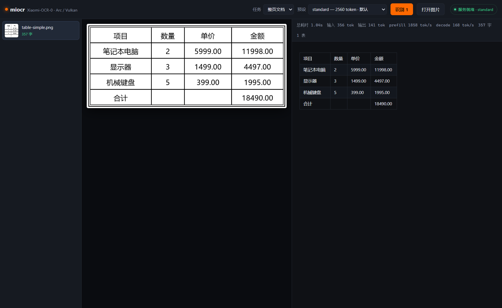

# M2 — Electron 桌面壳

M2 的目标是把 M1 的 core 管线包成一个能双击运行的本机应用：拖图 / 打开图 → 选任务与质量预设 → 识别 → 看结果。不含 PDF 批量、热键截图、导出（M3）。

当前状态：**已跑通**。`npm start` 一条龙构建 + 启动，点「识别」走完整链路（启 sidecar → 推理 → 渲染），实测表格页 1.04 s 出结果。



> 截图拍摄时项目名为 miocr，后改名为 moocr；界面与代码逻辑未变。

---

## 1. 结构

```
apps/desktop/src/main.ts      主进程：窗口、菜单、IPC、sidecar 生命周期
apps/desktop/src/preload.ts   contextBridge 白名单 API
apps/renderer/index.html      带 CSP 的壳
apps/renderer/src/App.tsx     三栏界面 + 状态机
apps/renderer/src/MarkdownView.tsx  Markdown/表格渲染（含 HTML 白名单）
apps/renderer/src/styles.css  深色主题
scripts/build-main.mjs        esbuild → apps/desktop/dist/{main,preload}.cjs
scripts/build-renderer.mjs    vite build → dist/renderer/
scripts/start-desktop.mjs     生产启动（构建产物检查 + 清环境变量）
scripts/dev-desktop.mjs       开发启动（vite dev server + HMR）
```

进程边界：

```
renderer (React, sandbox:false, contextIsolation:true)
   │  window.moocr.*  ← preload 白名单，无 ipcRenderer 直接暴露
   ▼
main (Node)  ──import──►  packages/core/pipeline.ts
   │                        └─ packages/inference/server.ts
   ▼
llama-server.exe (Vulkan, 端口 8090, 由主进程 spawn 并持有)
```

主进程直接 `import` core 的 `.ts` 源文件，靠 esbuild 打包（Node 24 的 type stripping 只在 CLI 用到）。好处是桌面端与 CLI 共用同一套退化守卫与后处理，不存在"UI 走的另一条路"。

---

## 2. 两个必须记住的坑

### 2.1 ELECTRON_RUN_AS_NODE

本机 shell 里 `ELECTRON_RUN_AS_NODE=1` 是设着的。它让 `electron.exe` 退化成纯 Node 进程：`require('electron')` 返回的是二进制路径字符串而不是内置模块，于是主进程第一行 `ipcMain.handle(...)` 就抛

```
TypeError: Cannot read properties of undefined (reading 'handle')
```

所有启动路径（`start-desktop.mjs`、`dev-desktop.mjs`）都在 spawn 前 `delete env.ELECTRON_RUN_AS_NODE`。手工验证时也要 `unset`。

### 2.2 渲染进程加载本地图片

dev 模式下页面是 `http://127.0.0.1:5183`，`file://` 图片会被拦；生产模式页面是 `file://`，但 CSP 只放行 `'self' data:`。两条路径统一走主进程读文件转 dataURL（`ipcMain.handle('read-image')`），顺手做 40 MB 上限与扩展名校验。

---

## 3. 安全边界

模型输出是不可信数据，直接进 `innerHTML` 等于在 Electron 里执行任意 HTML。桌面端只有一个注入点，且必须过白名单：

- `sanitizeTableHtml(html)` 只允许 `table/thead/tbody/tr/th/td` + `colspan/rowspan`（数值 clamp ≤ 64），`class` 一律剥掉，文本节点里出现裸 `<` 直接拒绝并退回 `<pre>` 显示原文。
- 其余内容全部走 React 元素，不存在 `innerHTML`。
- `index.html` 的 CSP：`default-src 'self'; img-src 'self' data:; style-src 'self' 'unsafe-inline'; script-src 'self'`。
- `contextIsolation: true`、`nodeIntegration: false`；preload 只暴露固定方法名，不暴露 `ipcRenderer`。

---

## 4. sidecar 生命周期

### 4.1 唯一所有权

主进程持有 `llama-server` 进程，preset 变化时 `stopServer` → `startServer`。`startServer` 默认 `refuseIfBusy`：端口上已有**别人**的服务就报错，绝不静默复用（复用会拿到不匹配的 `--image-max-tokens`，实测能让 accurate 预设实际跑 2560 预算）。

### 4.2 强杀残留的自愈

从任务管理器结束 Electron 时 `before-quit` 不会跑，`llama-server` 会作为孤儿进程留在 8090。做法：

- `startServer` 成功后在 `resources/models/.sidecar.json` 写 `{pid, port, imageMaxTokens, ctxPerSlot, startedAt}`，`stopServer` 删除。
- 启动时先 `reclaimStaleSidecar(root, port)`：端口健康 **且** 记录里的 pid 存活 **且** 端口一致 → 判定为自己上次的残留，杀掉并等端口释放后重来；否则返回 `foreign`，报错交给用户。

实测：手动起一个 `--image-max-tokens 1024` 的 llama-server 并伪造 pid 记录，再以 `standard`(2560) 启动 UI —— 旧进程被清掉，记录从 pid 7708/1024 变为 pid 10312/2560，识别正常。正常关闭路径（关窗口）则完全不残留。

---

## 5. 指标修正：KV 缓存把「输入 token」算成了个位数

同一张图、同一个 prompt 重复识别时，llama-server 命中前缀缓存，只处理增量：

```
第一次: usage.prompt_tokens=305  timings.prompt_n=305  prompt_per_second=1785
第二次: usage.prompt_tokens=356  timings.prompt_n=4    prompt_per_second=179
```

如果直接拿 `timings.prompt_n` 当输入量，UI 会显示「输入 4 tok / prefill 179 tok/s」——两个数字都是假的。现在：

- `promptTokens` 取 `usage.prompt_tokens`（含缓存部分），并单独暴露 `cachedTokens`；
- `prefillTps` 只在无缓存命中时给值，否则 `null`（宁可空着也不显示错数）；
- UI 展示成 `输入 356 tok（缓存 356）`，prefill 字段自动消失。

---

## 6. 交互

| 操作 | 行为 |
| --- | --- |
| 拖入图片 | `webUtils.getPathForFile` 取真实路径（拿不到时提示改用按钮） |
| 「打开图片」/ `Ctrl+O` | 多选对话框 |
| 命令行带图 | `moocr.exe a.png b.png` 或 `npm start -- a.png`，窗口就绪后注入 |
| 任务下拉 | document / text / table / formula（四段官方 prompt） |
| 预设下拉 | fast 1024 / standard 2560 / accurate 6144 / extreme 12288，改动会重启 sidecar |
| 「识别 N」 | 串行跑选中的文件，逐页 `progress` 事件驱动左下角进度 |
| 结果栏 | 耗时、输入/输出 token、prefill/decode tok/s、字数、表数、重试次数；warnings 单独一栏 |

任务与预设都从主进程 `capabilities` 拉，UI 不硬编码上限。缺模型时顶部直接给红条提示跑 `scripts/m0-fetch.sh`（0.2.0 起改为应用内下载，见 [M6](M6-RUNTIME.md)）。

---

## 7. 验证记录

| 场景 | 结果 |
| --- | --- |
| `npm start`（构建 + 启动） | 通过，窗口就绪，CDP 可见 |
| 空态 | 无 console 错误、无异常，三栏正常 |
| 命令行带 2 张图 | 列表出现缩略图 + 待识别，按钮变「识别 2」 |
| 点识别（冷启动 sidecar） | 2 s 内 `服务就绪 · standard`，两张都 done |
| 表格页渲染 | table-simple 5 行 4 列、table-merged `rowspan=2`+`colspan=2` 正确 |
| 日本語页 | 输出与 GT 完全一致（132 字） |
| 关闭窗口 | electron 与 llama-server 同时退出，8090 释放 |
| 强杀后重启 | 残留被 reclaim，新记录 `imageMaxTokens: 2560` |
| 单元测试 | postprocess 49 passed、core 26 passed |

时间与吞吐（A770，Q4_K_M，`--image-min-tokens 256`，standard 预设）：

| 页面 | 输入 tok | 输出 tok | 墙钟 | prefill | decode |
| --- | --- | --- | --- | --- | --- |
| table-simple | 356 | 141 | 1.04 s | 1858 tok/s | 168 tok/s |
| table-merged | 340 | 62 | 0.55 s | 1882 tok/s | 170 tok/s |
| ja-paragraph | 478 | 78 | 0.71 s | 2013 tok/s | 170 tok/s |
| ko-paragraph | 478 | 109 | 0.89 s | 2023 tok/s | 172 tok/s |

---

## 8. 已知限制

- **韩语仍然错**（`주출`/`매리类`/`마克다은`/`정화도`），与 CAPABILITY 一致：模型级缺陷，UI 不做特殊处理，等 M3 的「质量提示」统一呈现。
- 无字符级 bbox，右侧只能整块对照，点预览里的文字定位不到对应行。
- 一次识别串行跑完所有选中文件；`identify` 的 `timeoutMs` 是 900 s，dense 页 20–30 s 没问题，但极端密排页仍可能触到 `finish_reason=length`（会以 warning 显示）。
- 预设切换会重启 sidecar（约 12 s 加载），期间不能识别；UI 用状态灯提示，但不排队自动重试。
- 渲染器是手写的极简 Markdown，不支持嵌套列表、引用块、图片。模型实测只会输出标题/段落/列表/表格/LaTeX，超出部分按纯文本显示。
- 未做打包（electron-builder），`npm start` 依赖仓库内 `node_modules` 与 `resources/`。打包放到 M4。

---

## 9. 给 M3 的接口

- `runBatch(requests, concurrency, onDone)` 已在 core 里，PDF 逐页渲染后直接喂它即可，UI 只需把「一页」换成一页位图。
- 导出功能建议在主进程加 `ipcMain.handle('save', {defaultName, content})`，走 `dialog.showSaveDialog`；Markdown/HTML/DOCX 三种格式各一个 serializer，放在 `packages/exporters/`。
- 热键截图需要 `globalShortcut` + `desktopCapturer`；截到区域后直接定位到剪贴板 → 走同一条 `runPage`。
- KIE 任务用的是「prompt + JSON schema」，`PROMPTS` 里加 `kie` 即可，但需要额外传 schema 字段，`complete()` 的签名要扩一个 `extraText`。
